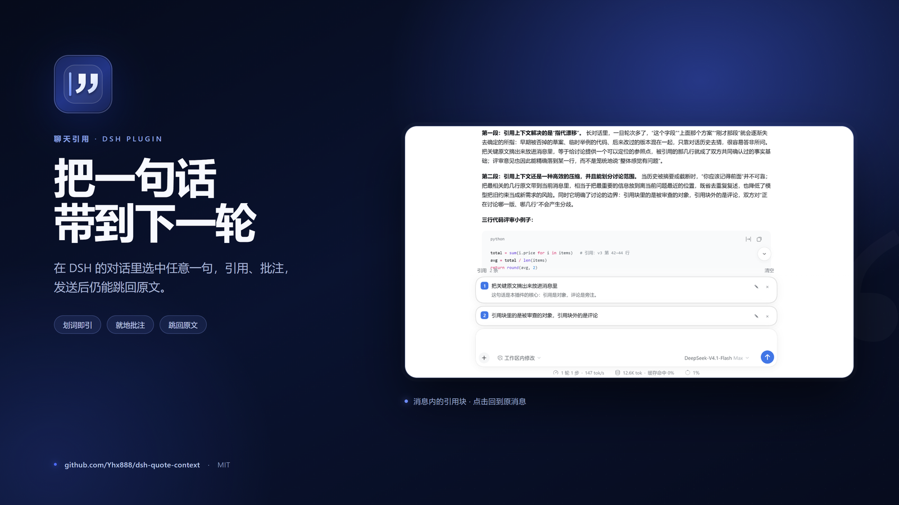
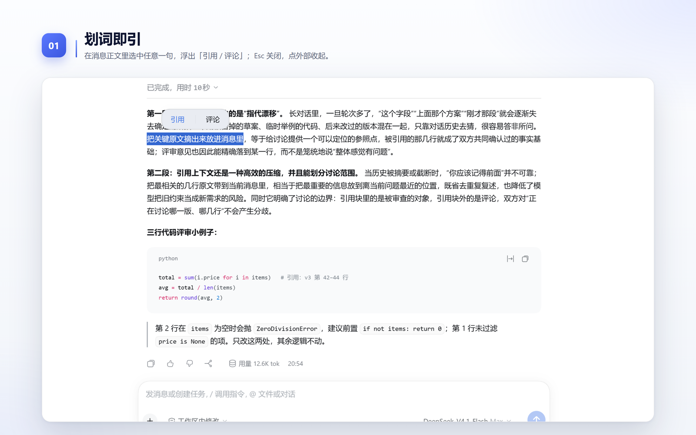
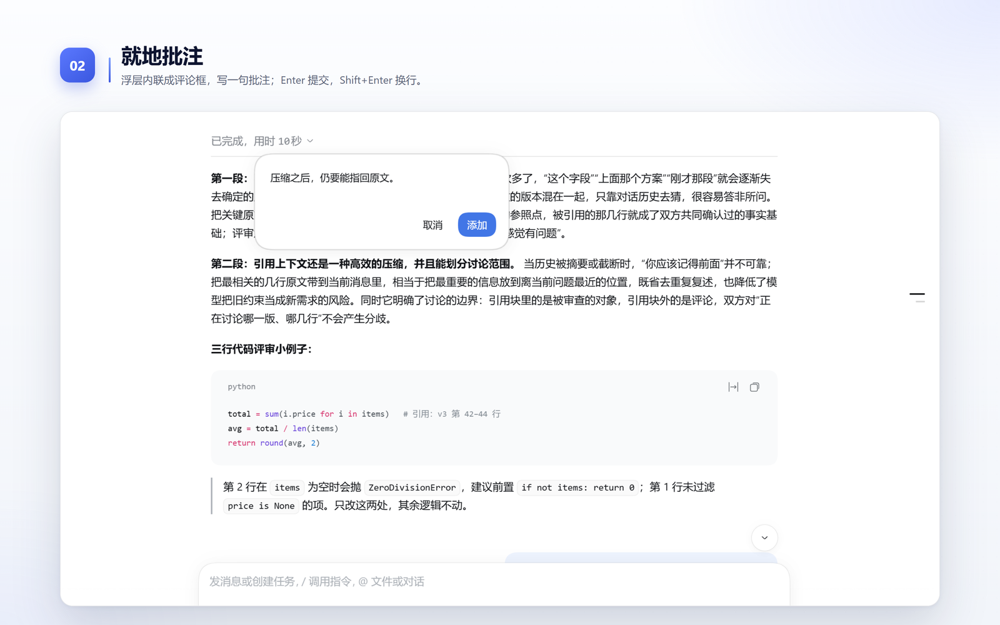
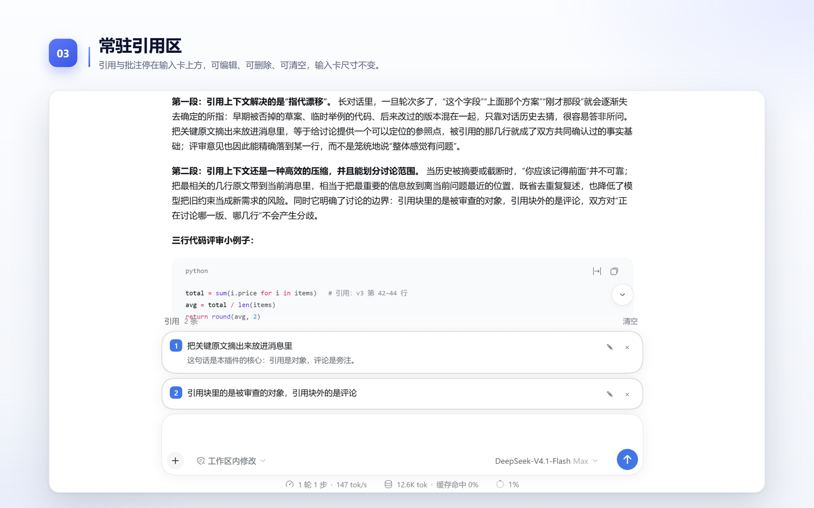
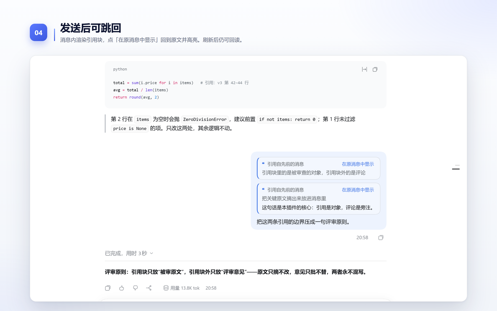
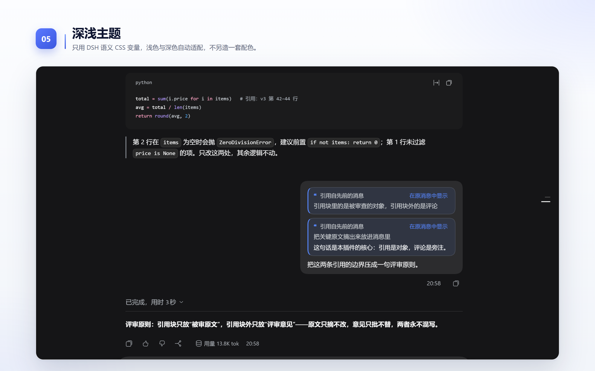

<p align="center">
  
</p>

# dsh-quote-context

[](https://github.com/Yhx888/dsh-quote-context/releases)
[](LICENSE)
[](package.json)

> Select text in a DSH message → quote or comment → the quote waits in a dock above the composer → after sending, the message carries a “quoted from an earlier message” card that jumps back to the source and highlights it.

[中文](README.md) · **English**

A native DSH take on [OpenChamber](https://github.com/openchamber/openchamber)'s chat-quote pattern. It borrows DSH's composer card, brand blue, hairline borders, radii and type scale — not OpenChamber's skin.

## Screens

| 01 · Quote on selection | 02 · Comment in place |
| --- | --- |
|  |  |

| 03 · Persistent quote dock | 04 · Jump back after sending |
| --- | --- |
|  |  |



Icon and screenshot art direction: [docs/design.md](docs/design.md).

## Features

- **Selection bar**: select text in any message; **Quote** / **Comment** appears. Esc or an outside click dismisses it.
- **Comment**: inline textarea, Enter to submit, Shift+Enter for a newline; the quote and comment enter the dock together.
- **Quote dock**: a persistent list above the composer (inserted before `[data-composer-card]`, so the composer never changes size). Each row = index + one-line source + comment + edit/remove; indices renumber after removal; clear-all is supported.
- **Quote card after sending**: “Quoted from an earlier message” + source (4 lines folded by default) + comment + **Show in the original message**; the source scrolls into view and is highlighted.
- **Survives reloads**: quote coordinates travel inside the message text, so a reloaded session still parses and jumps.
- **Light / dark**: only DSH semantic CSS variables (`--dsw-alias-*`); no second palette.

## Install

Requires DSH `0.2.1-rc.3` (or compatible) and Node ≥ 18. Plain Node, no build step.

```powershell
dsh plugin --profile web add github:Yhx888/dsh-quote-context
```

Or install the release tarball:

```powershell
dsh plugin --profile web add https://github.com/Yhx888/dsh-quote-context/releases/download/v0.1.1/dsh-quote-context-0.1.1.tgz
```

Local development:

```powershell
dsh plugin --profile web add "link:C:/path/to/dsh-quote-context"
```

Desktop: the official desktop profile is managed by Electron; install the repository folder from the in-app Plugins page (or add it to `dsh.profile.bundles` through the profile's pnpm flow).

## Wire format

DSH messages are plain text. On send, the quote source expands each quote into:

```text
> ❝ first source line
> second source line
> ❞ first comment line
> ※ │qc1:<base64url(JSON)>
```

The `※` line is the transport coordinate (stripped by the UI, still readable to the model). A failed parse keeps the text as-is and never blocks the send.

## Compatibility

- Target: DSH `0.2.1-rc.3` web client. DOM contract: `[data-conversation-content]`, `[data-conversation-session]`, `[data-chat-anchor-key]`, `[data-composer-card]`, `[data-composer-input]`.
- Host services: `slots`, `locale`, `conversation.input` (quote chip), `inputTriggers` (send-time codec). If one is missing the action reports a failure instead of writing a half quote.
- Does not share triggers/sources with the built-in `@` reference or `dsh-quote-deck`; both compete for the selection bar, so pick one.

## Development

```bash
node --check lib/client.js
npm test
```

## License

MIT. Selection handling, wire format and the DOM test shim are reused from [dsh-quote-deck](https://github.com/YHX/dsh-quote-deck) (MIT, forked from `dsh-client-ui-quote`); interaction references [OpenChamber](https://github.com/openchamber/openchamber).
