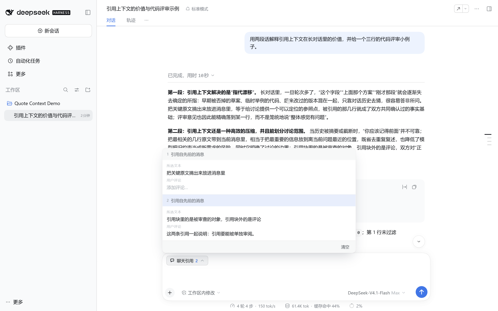
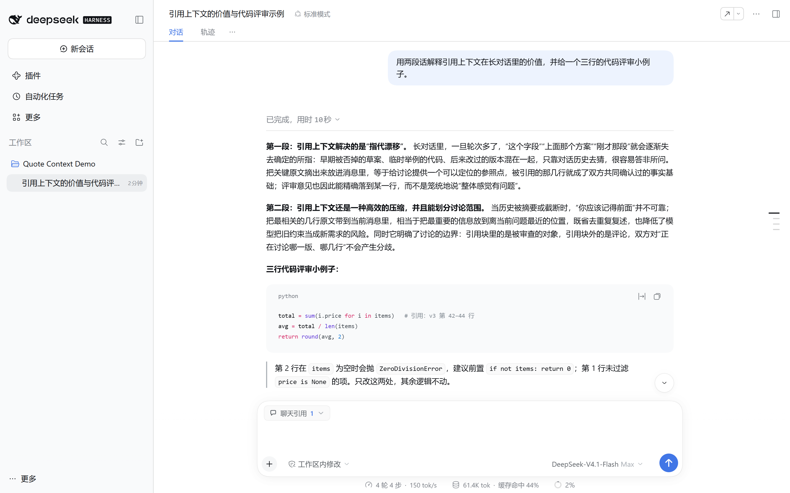
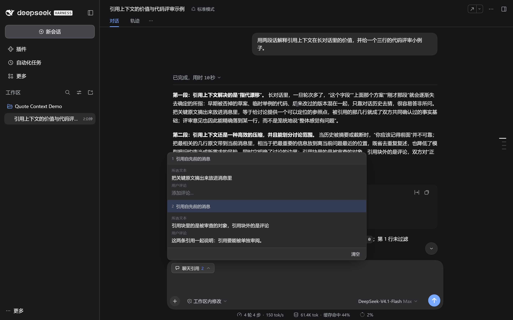
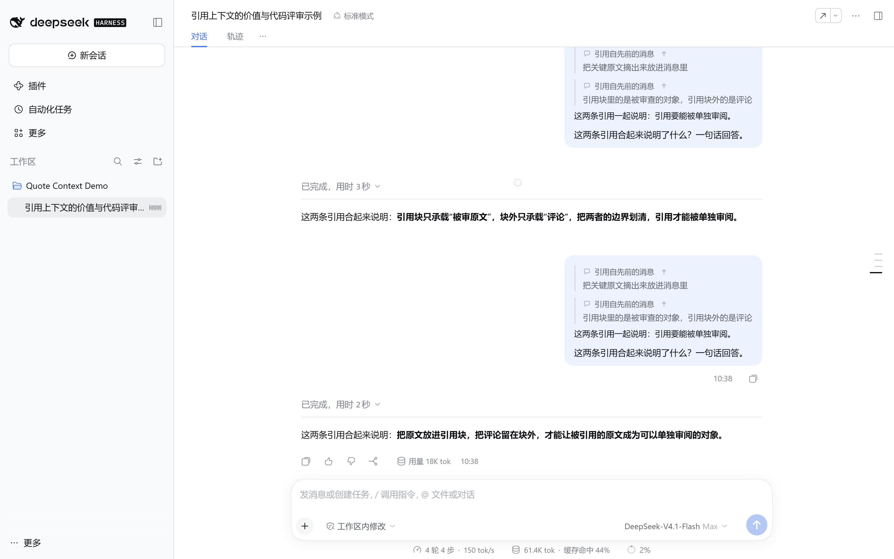
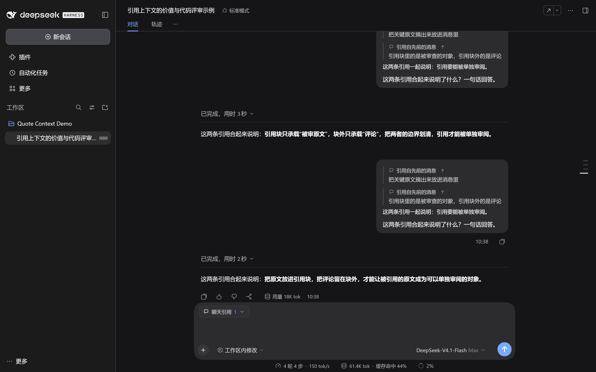

# dsh-quote-context

[](https://github.com/Yhx888/dsh-quote-context/releases)
[](LICENSE)
[](package.json)

<p align="center">
  
</p>

> Select text in a DSH chat → quote or comment on it → the quote waits in a **Chat quotes N** chip at the top of the composer; hover or click to expand the preview, edit comments, remove items — and only the send gesture folds the quote block into the message.

[中文](README.md) · **English**

The interaction follows [OpenChamber](https://github.com/openchamber/openchamber)'s chat-quote pattern (chip + stacked hover preview); the visual language borrows DSH's own composer, semantic tokens, hairlines and radii.

## Screens

| 01 · Collapsed | 02 · Expanded |
| --- | --- |
|  |  |

| 03 · Dark | 04 · After sending |
| --- | --- |
|  |  |



## Why quotes stay out of the composer

0.1.x inserted a native reference chip per quote into the composer. It was hidden with CSS, but it still **occupied a position in the draft's text flow**:

- Backspace/Delete in the composer selected the chip first and then removed it — the quote disappeared with it;
- typing into the text ran into the invisible chip;
- undo, select-all and session switches all carried the chip along.

Since 0.2.0 quotes live **outside the draft**:

- the composer only shows one **Chat quotes N** chip — composer chrome, not editable text;
- the delete key can only delete your own words;
- at the send gesture (Enter, Ctrl/⌘+Enter, the send button) the quote block is folded into the outgoing text and handed to the host's own send path — delivery mode, attachments and optimistic echo are unchanged;
- if the host rejects the send, your text comes back and the quotes return to the chip.

## Features

- **Selection bar**: select text in a message to get Quote and Comment; Escape or an outside click closes it.
- **Comments**: an inline textarea in the bar, Enter submits, Shift+Enter adds a line.
- **Collapsible chip**: one 28px chip at the top of the composer (bubble icon + count); it disappears when there are no quotes and the composer shrinks back.
- **Preview popover**: opens on hover, pins on click; each row = index + "Quoted from an earlier message" + Selected text (click to jump back and highlight) + Your comment (edit in place, Enter saves) + remove; a Clear footer appears with two or more.
- **Fresh preview**: a newly added quote opens the popover for ~2.4s and highlights that row, then it closes unless hovered or pinned.
- **Send folding**: quotes first, your text after, same wire format; command messages (starting with /) carry no quotes and say so.
- **Sent quote block**: rendered as a reply — a hairline bar, the source caption, the quote (clamped to 4 lines, click to expand) and your comment as normal text; "Show in the original message" scrolls back and flashes the source.
- **Readable after refresh**: coordinates travel in the message text, so a reloaded session still parses and jumps.
- **Light and dark**: DSH semantic variables only (`--dsw-alias-*`, `--dsw-elevation-*`, `--dsw-specific-input-major`).

## Install

DSH `0.2.1-rc.3` or compatible, Node ≥ 18. Plain Node, no build step.

```powershell
dsh plugin --profile web add https://github.com/Yhx888/dsh-quote-context/releases/download/v0.2.0/dsh-quote-context-0.2.0.tgz
```

or from source:

```powershell
dsh plugin --profile web add github:Yhx888/dsh-quote-context
```

Local development (link):

```powershell
dsh plugin --profile web add "link:C:/path/to/dsh-quote-context"
```

Desktop: the Electron app owns `profiles/desktop`; install from the plugin page or through the profile's pnpm flow and add the package to `dsh.profile.bundles`.

## Usage

1. Select text in any user or assistant message.
2. Quote adds it straight away; Comment asks for an optional note first.
3. The composer shows Chat quotes N. Hover or click: read each quote, edit its comment, remove it, or clear all.
4. Type your question as usual — the composer only holds your words.
5. Send: the quote blocks travel with your text and render as jumpable quote cards in the message.

## Wire format

```text
> ❝ first line of the quote
> second line
> ❞ first line of the comment
> second line
> ※ │qc1:<base64url(JSON)>
```

- The `❞` section is omitted without a comment; the `※` line carries coordinates, is stripped in the UI and stays readable to the model.
- The JSON holds `{v,s,i,t,c,a}`: version, session, quote id, text, comment, anchor (row key / ordinal / context).
- Unparseable content stays plain text and never blocks sending.

## Compatibility

- Target: DSH `0.2.1-rc.5` web client; DOM contract: `[data-conversation-content]`, `[data-conversation-session]`, `[data-chat-anchor-key]`, `[data-chat-node-key]`, `[data-composer-card]`, `[data-composer-input]`, `[data-conversation-scroll]`.
- Host services: `slots`, `locale`, `conversation.input.shell()` (read/write the draft). 0.2.0 no longer registers an `inputTriggers` source and never inserts chips.
- Does not share a source/trigger with the built-in `@` references or `dsh-quote-deck`; both claim the selection bar, so install one.

## Development

```bash
node --check lib/client.js
npm test
```

## Verification

See [docs/verification.md](docs/verification.md) for the isolated-instance run: quote → hammer Delete in the composer → send → reload, plus light and dark captures.

## License

MIT. Wire format, selection bar and the DOM test shim reuse verified work from [dsh-quote-deck](https://github.com/YHX/dsh-quote-deck) (MIT, forked from `dsh-client-ui-quote`); interaction follows [OpenChamber](https://github.com/openchamber/openchamber).
